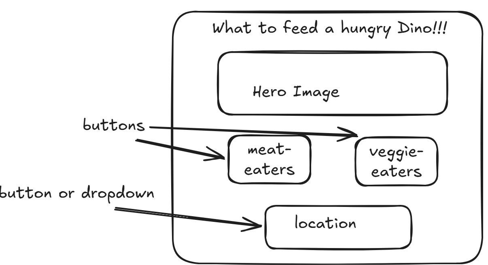

# Dinosaurs
   My app is for kids that want to know what a dinosaur ate and where they lived.

## Wireframe

   

## Target users
   Children who want to learn about dinosaurs.

## Features to include
   Buttons to press for information
   Maybe a dropdown as well.

 
## Sample table
   id | name | diet | dino_type | length_in_meters | fossil-found |
   | --- | --- | --- | --- | --- | --- |
| 1 | gorgosaurus | carnivore | large theropod | 9 | alberta |
| | | | | | |

## accountability partners
  miaya-dennis
  edwardcoded77
  Anastasia-2012
  KevinikaL